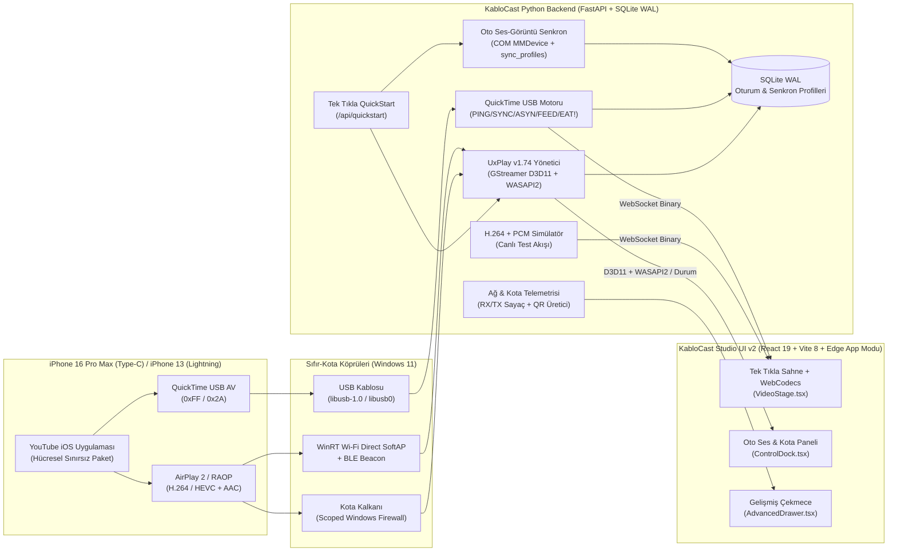

# KabloCast — Mimari ve Görsel Tasarım Dokümanı

## 1. Sistem Mimarisi

## 2. Veritabanı Şeması (SQLite WAL)
- `sessions`: `id`, `mode` (`usb_quicktime` | `airplay_uxplay` | `simulator`), `device_name`, `device_model`, `started_at`, `ended_at`, `duration_sec`, `video_codec`, `resolution`, `avg_fps`, `bytes_received`, `estimated_saved_mb`
- `settings`: `key` (PRIMARY KEY), `value`, `updated_at`
- `driver_backups`: `id`, `instance_id`, `previous_service`, `backup_json_path`, `created_at`
- `sync_profiles`: `profile_key` (`<endpoint_id>::<device_key>`), `audio_endpoint_id`, `audio_label`, `device_key`, `mode` (`auto` | `manual`), `manual_offset_ms`, `updated_at`

## 3. Görsel Kimlik & Design DNA (`visual-project-protocol`)
- **Konsept:** Sıcak Anodize Donanım & Yayın Monitörü Stüdyosu (Braun / Blackmagic DaVinci Studio Monitörü esintili; sıfır neon/cyberpunk).
- **Renk Sistemi (`oklch()` DTCG v2025.10):**
  - `--surface-canvas`: `oklch(0.17 0.006 85)` (Sıcak kömür tuval)
  - `--surface-panel`: `oklch(0.22 0.008 85)` (Anodize grafit kartlar)
  - `--surface-elevated`: `oklch(0.27 0.010 85)` (Üst kontrol çubuğu / popover)
  - `--ink-primary`: `oklch(0.95 0.008 85)` (Yüksek kontrast fildişi metin)
  - `--ink-muted`: `oklch(0.73 0.012 85)` (İkincil meta etiketler — WCAG >= 4.5:1)
  - `--accent-copper`: `oklch(0.68 0.16 40)` (Bakır kablo / ana eylem vurgusu)
  - `--signal-emerald`: `oklch(0.72 0.14 152)` (Aktif sıfır-kota bağlantı ışığı)
  - `--signal-amber`: `oklch(0.77 0.15 75)` (Sürücü / Ağ uyarısı)
  - `--border-subtle`: `oklch(0.32 0.009 85)` (İnce 1px donanım çizgisi)
- **Tipografi:**
  - Başlık / Gövde: `Plus Jakarta Sans`, sistem sans fallback
  - Telemetri / IP / FPS / MB Sayaçları: `JetBrains Mono` (`font-variant-numeric: tabular-nums`)
- **Yerleşim Hiyerarşisi:**
  - Üst ince Stüdyo Başlık Çubuğu (Durum pili, aktif mod, canlı kota tasarruf sayacı, Kılavuz/Ayarlar butonu)
  - Sol/Ana Sahne (~%68 genişlik, `min-width: 0; min-height: 0`): 16:9 / 9:16 uyarlanabilir video monitörü (`<canvas>` + oynatma kontrolleri + döndürme + tam ekran + dudak senkronu)
  - Sağ Kontrol Kızağı (~%32 genişlik, mobilde alt sekme): 3 net sekme (`Kablolu USB`, `Kablosuz AirPlay`, `Kota & Ağ`)
