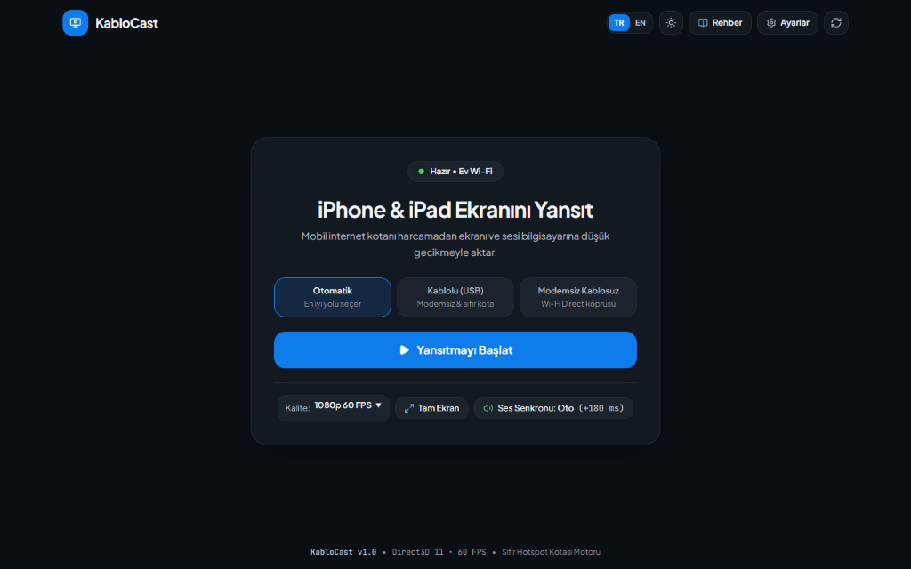
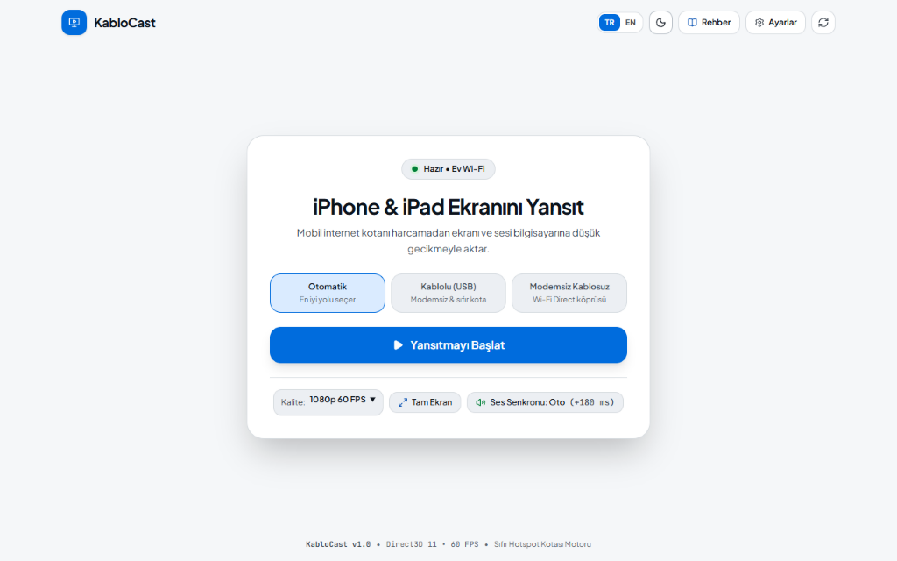
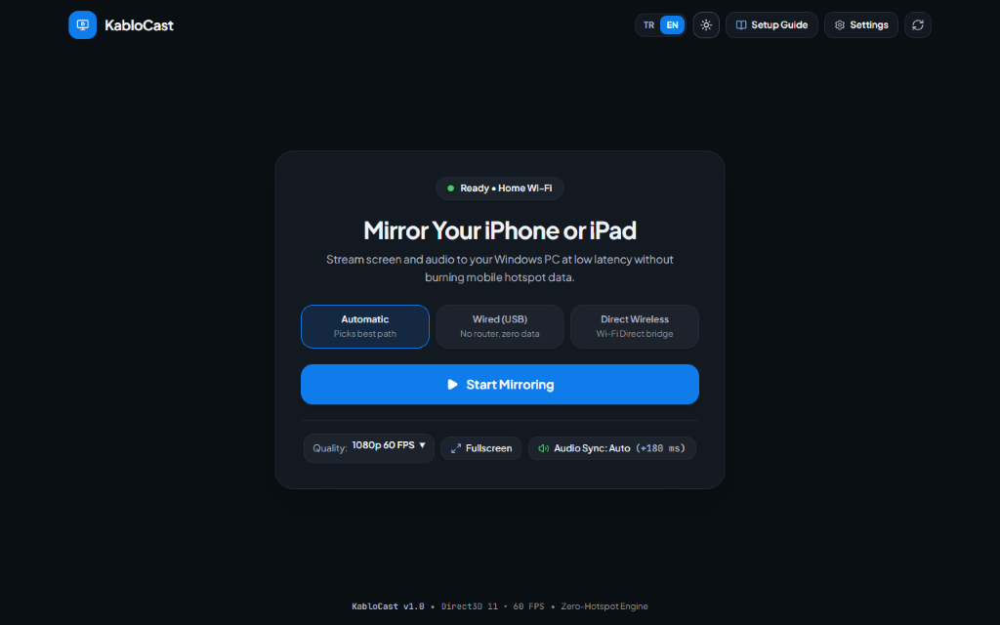

# KabloCast

**Zero-Quota iPhone & iPad Screen + Audio Mirroring for Windows 11**  
*One-click setup, automatic A/V sync per audio device, hardware-accelerated D3D11 + WASAPI2 streaming, and built-in Wi-Fi Direct + Quota Shield.*

[English](#english) · [Türkçe](#türkçe)

---



<details>
<summary>More Screenshots (Light Mode & English UI)</summary>

| Light Mode (TR) | English UI (Dark) |
| :---: | :---: |
|  |  |

</details>

---

## English

### Why KabloCast?
When you rely on mobile data or want to keep your mobile hotspot allowance untouched (for example, watching YouTube inside your phone's native unlimited app), tethering a laptop over hotspot and opening the browser burns your shared hotspot quota. **KabloCast** keeps video playback directly on your iPhone or iPad and mirrors only the local H.264/HEVC video and stereo audio stream to your Windows 11 PC at 60 FPS.

### Key Features
- **One-Click Smart Launch (`POST /api/quickstart`):** Automatically ensures Apple USB drivers are in standard composite mode (`usbccgp`), verifies/installs the Windows `Bonjour` mDNS service, selects the optimal zero-quota bridge (`Home Wi-Fi`, `Wired USB Network`, or `Wi-Fi Direct`), and launches the AirPlay 2 receiver.
- **Automatic A/V Sync Calibration (`audio_sync.py`):** Reads your active Windows default audio endpoint via COM `IMMDeviceEnumerator` (speakers, wired headsets, HDMI/DisplayPort monitors, 2.4 GHz wireless headsets, or Bluetooth) and calibrates source audio latency (`-al`) automatically. Manual fine-tuning is persisted per `(audio endpoint, iOS device)` pair in SQLite (WAL).
- **Hardware-Accelerated Rendering:** Zero-copy Direct3D 11 video (`d3d11h264dec → d3d11convert → d3d11videosink`) + WASAPI2 stereo audio (`wasapi2sink`) with instant `Alt + Enter` / live borderless fullscreen ↔ windowed switching.
- **Zero-Leak Quota Shield:** Service-scoped Windows Firewall rules (`-Service wuauserv/BITS/DoSvc`, OneDrive, Edge Updater) block background Windows hotspot leakage without ever breaking DNS or regular browsing.
- **No-Router Wi-Fi Direct Mode:** Built-in WinRT `WiFiDirectAdvertisementPublisher` + BLE beacon + scannable QR code + blank-router Manual IP guide so cellular data stays active on iOS while video streams directly to the laptop.
- **Bilingual & Theme-Ready UI:** Clean single-focus React 19 + Tailwind CSS v4 studio supporting **English / Turkish** and **Light / Dark** themes, plus a WebCodecs + AudioWorklet H.264 test simulator.

### Quick Start (Windows 11)
1. **Clone the repository** and place the portable AirPlay binaries in [`runtime/uxplay/`](runtime/uxplay/README.md).
2. **Run initial setup:**
   ```bat
   setup.bat
   ```
3. **Launch KabloCast:**
   Double-click **`KabloCast.exe`** (no console window; or right-click → *Run as administrator* so UAC prompts for Bonjour/Firewall are seamless). You can rebuild the executable anytime via `build_exe.bat`.
4. Click **Start Mirroring**, then open **Control Center → Screen Mirroring → `KabloCast`** on your iPhone or iPad.

### Tech Stack
- **Backend:** Python 3.12+, FastAPI, Pydantic v2, SQLite (WAL), `psutil`, `pyusb`, `av`, `qrcode`, Win32 COM/Registry APIs.
- **Frontend:** React 19, TypeScript, Vite 8, Tailwind CSS v4, WebCodecs `VideoDecoder`, AudioWorklet.
- **Media Engine:** Portable `uxplay-windows` (GStreamer D3D11 + WASAPI2) + custom QuickTime USB AV (QVH) fallback & H.264/LPCM simulator.

---

## Türkçe

### KabloCast Nedir?
Evde sabit Wi-Fi olmadığında veya telefonunuzdaki sınırsız video/YouTube paketini bilgisayar üzerinden hotspot açarak tüketmek istemediğinizde, **KabloCast** videoyu doğrudan iPhone veya iPad'inizde oynatır; yalnızca yerel sıkıştırılmış görüntü ve stereo sesi 60 FPS akıcılıkta Windows 11 bilgisayarınıza aktarır.

### Öne Çıkan Özellikler
- **Tek Tıkla Akıllı Başlatma:** Bağlı iPhone/iPad yanlış USB sürücüsünde kaldıysa otomatik Apple standart moduna (`usbccgp`) döndürür, `Bonjour` servisini hazırlar, en uygun sıfır-kota ağ yolunu (`Ev Wi-Fi`, `Kablolu USB` veya `Modemsiz Wi-Fi Direct`) seçer ve AirPlay 2 alıcısını başlatır.
- **Otomatik Ses-Görüntü Senkronu:** Windows'un o an aktif olan ses çıkış aygıtını (hoparlör, kablolu/kablosuz kulaklık, monitör sesi veya Bluetooth) otomatik tanıyıp kaynak ses gecikmesini (`-al`) kendisi ayarlar. İsterseniz tek dokunuşla ince ayar yapıp o kulaklık/hoparlör için kalıcı kaydedebilirsiniz.
- **Donanım İvmeli 60 FPS Yayın:** Sıfır-kopya D3D11 video + WASAPI2 stereo ses ve `Alt + Enter` ile veya arayüzden yayın kesilmeden çerçevesiz Tam Ekran ↔ Pencere modu geçişi.
- **Güvenli Kota Kalkanı:** Hotspot veya USB ağı açıkken yalnızca `wuauserv`, `BITS`, `DoSvc`, `OneDrive` ve `Edge Güncelleyici` arka plan indirmelerini engeller; DNS ve tarayıcınızı asla kesmez.
- **Modemsiz Wi-Fi Direct Modu:** Evde modem yokken dizüstü bilgisayardan doğrudan yerel Wi-Fi ağı + QR kod + "Yönlendirici Boş" elle IP rehberi üretir; iPhone internete hücreselden devam ederken görüntüyü laptopa aktarır.
- **Çift Dilli & Çift Temalı Arayüz:** Tek odaklı modern React 19 arayüzü **Türkçe / İngilizce** ve **Açık / Koyu** tema desteği sunar.

### Hızlı Kurulum (Windows 11)
1. Depoyu indirin ve taşınabilir AirPlay dosyalarını [`runtime/uxplay/`](runtime/uxplay/README.md) içine yerleştirin.
2. İlk kurulum için çalıştırın:
   ```bat
   setup.bat
   ```
3. Doğrudan **`KabloCast.exe`** dosyasına çift tıklayın (siyah konsol penceresi açılmaz), **Yansıtmayı Başlat** butonuna basın ve iPhone/iPad'inizde **Denetim Merkezi → Ekran Yansıtma → `KabloCast`** seçin.

---

## License
Released under the [MIT License](LICENSE).
